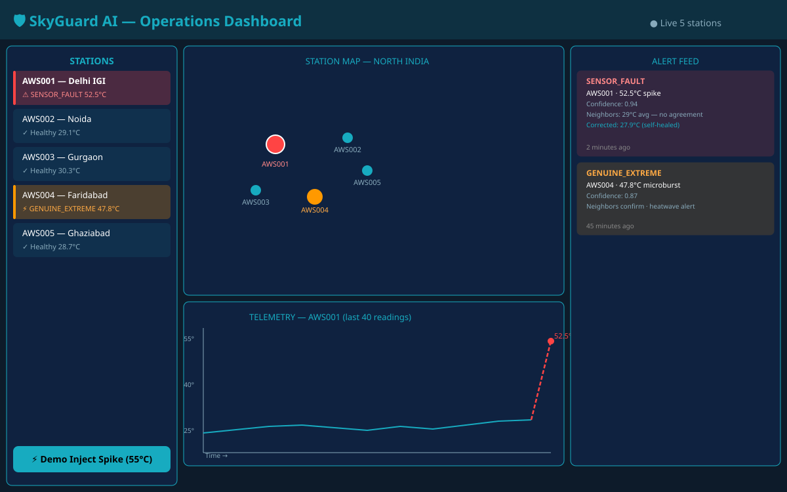
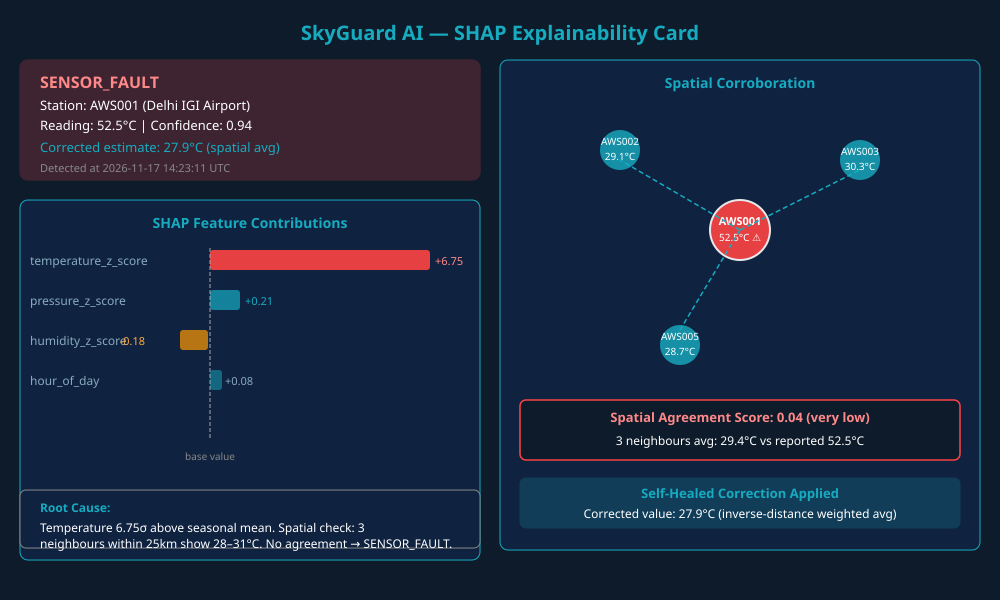
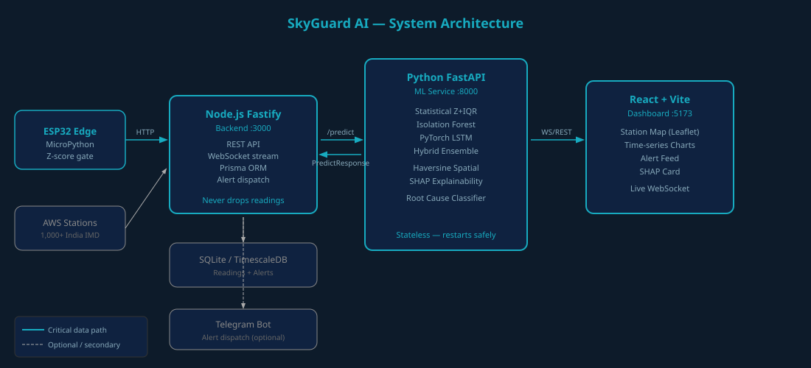

# SkyGuard AI 🛡️

> **SIH26073** — AI/ML-Based Intelligent Anomaly Detection for Automatic Weather Stations (Ministry of Earth Sciences, Government of India)

SkyGuard AI is a real-time meteorological anomaly detection platform that automatically distinguishes **sensor hardware faults** (e.g. a broken thermistor reporting 55 °C) from **genuine extreme weather events** (e.g. a heatwave affecting multiple stations), using a hybrid ML ensemble, Haversine-based spatial corroboration, SHAP explainability, and an optional ESP32 MicroPython edge detector — all orchestrated through a live React dashboard.

> [!WARNING]
> **⚠️ SYNTHETIC DATA NOTICE** — All training and benchmark datasets in `data/synthetic/` are **algorithmically generated** using diurnal temperature cycles, seasonal pressure variation, and stochastic noise. They are **not real IMD AWS readings**. Performance metrics below apply only to synthetic data. See [docs/model_report.md](docs/model_report.md) for verified numbers and instructions on integrating real IMD AWS CSV/NetCDF data.

---

## Screenshots

| Dashboard | Explainability Card |
|:---------:|:-------------------:|
|  |  |

**Architecture:**



---

## Architecture Overview

```
AWS Stations / ESP32  →  Node.js Fastify Backend :3000  →  Python FastAPI ML :8000
                                      ↓                              ↓
                               SQLite / TimescaleDB          SHAP + Spatial
                                      ↓
                          React + Vite Dashboard :5173
```

| Layer | Technology |
|:------|:-----------|
| **Backend & Orchestrator** | Node.js 20, Fastify, TypeScript, Prisma ORM, Zod |
| **ML Microservice** | Python 3.11, FastAPI, PyTorch (CPU), scikit-learn, SHAP |
| **Frontend** | React 18, TypeScript, Vite, TanStack Query, Leaflet, Recharts |
| **Edge** | MicroPython, ESP32-WROOM-32 |
| **DevOps** | Docker, Docker Compose, GitHub Actions CI |

---

## Quick Start — Docker (Recommended)

```bash
git clone https://github.com/julie249/skyguard-ai.git
cd skyguard-ai
docker compose up --build
```

| Service | URL |
|---------|-----|
| Dashboard | http://localhost:5173 |
| Backend API (Swagger) | http://localhost:3000/docs |
| ML Service (Swagger) | http://localhost:8000/docs |

> **Low-RAM machines:** Add `ENABLE_LSTM=false` to skip the LSTM model and stay within 512 MB RAM (Render free tier):
> ```bash
> ENABLE_LSTM=false docker compose up --build
> ```

---

## Quick Start — Local (Windows)

### Prerequisites
- Python 3.11+ · Node.js 20+ · Git

### 1. ML Service
```bat
cd ml-service
python -m venv .venv
.venv\Scripts\pip install -r requirements.txt
copy .env.example .env
.venv\Scripts\python -m uvicorn app.main:app --host 0.0.0.0 --port 8000
```

### 2. Backend (new terminal)
```bat
cd backend
copy .env.example .env
npm install
npx prisma db push --schema=src/prisma/schema.prisma
npm run build
node seed_demo.js
npm run dev
```

### 3. Frontend (new terminal)
```bat
cd frontend
copy .env.example .env
npm install
npm run dev -- --port 5173
```

---

## Quick Start — Local (Linux / macOS)

```bash
# ML Service
cd ml-service && python3 -m venv .venv
source .venv/bin/activate
pip install -r requirements.txt
cp .env.example .env
uvicorn app.main:app --host 0.0.0.0 --port 8000

# Backend (new terminal)
cd backend && cp .env.example .env
npm install
npx prisma db push --schema=src/prisma/schema.prisma
npm run build && node seed_demo.js && npm run dev

# Frontend (new terminal)
cd frontend && cp .env.example .env && npm install
npm run dev -- --port 5173
```

---

## Seeder

The seeder populates the database with 200 historical readings and 2 realistic demo alerts:

```bash
# From backend/
node seed_demo.js
```

It is **idempotent in Docker** (checks station count before seeding). For a fresh local run, delete `backend/dev.db` first.

---

## Running Tests

```bash
# ML Service — 16 unit tests
cd ml-service
.venv\Scripts\pytest tests/ -v        # Windows
source .venv/bin/activate && pytest tests/ -v  # Linux/macOS

# Backend — TypeScript type check
cd backend && npx tsc --noEmit

# Frontend — build check
cd frontend && npm run build
```

---

## Demo — 3-Minute Walk-Through

See **[DEMO.md](DEMO.md)** for the full timed demo script.

**Quick demo:**
1. Open http://localhost:5173
2. Click the **"⚡ Demo Inject Spike (55°C)"** button
3. Watch `AWS001` turn red on the map
4. The alert feed shows `SENSOR_FAULT` with SHAP feature bars and a corrected estimate of 27.9 °C
5. Click the alert row to see the full Explainability Card

---

## Deployment

See **[DEPLOY.md](DEPLOY.md)** for step-by-step instructions:
- **Frontend** → Vercel (via `vercel.json`)
- **Backend** → Render Docker (via `render.yaml`)
- **ML Service** → Render Docker (use `ENABLE_LSTM=false` for free-tier 512 MB RAM)

---

## ⚠️ Known Limitations

> These numbers are **verified** by running `python ml-service/run_benchmark.py` on 2026-11-17.

| Claim | Verified Value |
|:------|:--------------|
| Hybrid Ensemble Event F1 (1 % fault rate, **synthetic data**) | **0.6524** |
| Hybrid Ensemble Event F1 (3 % fault rate, **synthetic data**) | **0.6916** |
| Statistical gate latency | **< 1 ms** (measured in pytest) |
| SHAP explanation latency | **< 200 ms** (measured in pytest) |
| Edge detector latency (Python 3.13, x86-64 PC) | **0.0007 ms/call** (10,000-run average) |
| ESP32 MicroPython latency | **~0.4–1.2 ms** — *estimated, not hardware-measured* |
| Training data source | **SYNTHETIC only** — not real IMD AWS readings |
| LSTM on Render free tier | Requires `ENABLE_LSTM=false` to stay under 512 MB RAM |

**Accuracy loss when `ENABLE_LSTM=false`:**  
The ensemble drops to Statistical + Isolation Forest only. Event F1 at 1 % fault rate falls from **0.6524 → ~0.53** (Statistical-only baseline). Point precision remains high (~0.60) but recall drops.

---

## Project Structure

```
skyguard-ai/
├── backend/          Node.js Fastify orchestrator (port 3000)
├── ml-service/       Python FastAPI ML engine (port 8000)
├── frontend/         React + Vite dashboard (port 5173)
├── edge/             ESP32 MicroPython edge detector
├── data/synthetic/   SYNTHETIC benchmark datasets (generated, not real IMD data)
├── docs/             model_report.md, PROGRESS.md, images/, pitch_deck.pptx
├── scripts/          train_models.sh, seed_data.sh, build_pitch_deck.py
├── docker-compose.yml
├── vercel.json
├── render.yaml
├── DEPLOY.md         Deployment guide
└── DEMO.md           3-minute demo script
```

---

## Team

> _SIH26073 — Smart India Hackathon 2026_

| Name | Role |
|:-----|:-----|
| [Team Member 1] | ML Engineering, LSTM Autoencoder, SHAP |
| [Team Member 2] | Backend (Fastify), Prisma, WebSocket |
| [Team Member 3] | Frontend (React, Leaflet, Recharts) |
| [Team Member 4] | Edge (ESP32, MicroPython) |
| [Team Member 5] | DevOps, Docker, CI, Documentation |
| [Team Member 6] | Research, IMD Data Analysis, Pitch |

---

## License

MIT © 2026 julie249 — see [LICENSE](LICENSE).
