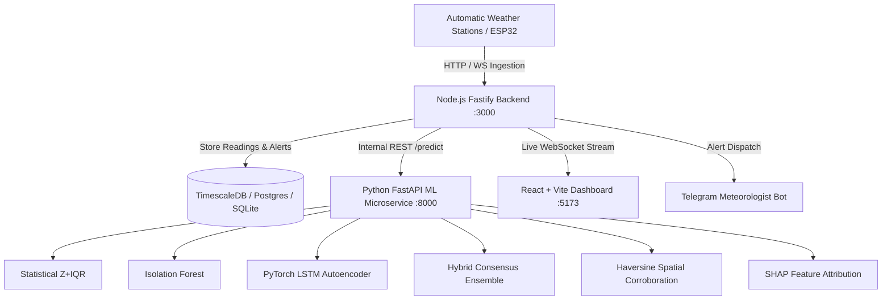

# SkyGuard AI

> **SIH26073**: AI/ML-Based Intelligent Anomaly Detection for Automatic Weather Stations (Ministry of Earth Sciences)

SkyGuard AI is an enterprise-grade meteorological anomaly detection, root-cause diagnosis, and self-healing platform. It detects and classifies sensor failures (spikes, stuck values, dropouts, calibration drift, noise bursts) across Automatic Weather Station (AWS) networks using temperature (°C), atmospheric pressure (hPa), and relative humidity (%).

---

## Architecture Overview

SkyGuard AI utilizes an intentional two-service microservice architecture:
- **Node.js (Fastify + TypeScript)**: The public orchestration engine. Owns the database (Prisma + TimescaleDB/Postgres/SQLite), REST API, high-concurrency WebSocket telemetry streaming, automated alerting (Telegram integration), and graceful degradation.
- **Python (FastAPI)**: Internal-only ML microservice. Owns feature engineering, statistical Z+IQR gating, Isolation Forest, PyTorch LSTM Autoencoders, weighted ensemble inference, Haversine geospatial validation, and SHAP explainability.
- **React + Vite (TypeScript)**: Responsive operations dashboard with Leaflet geospatial station mapping, Recharts telemetry time-series, live WebSocket alerts, and SHAP explainability panels.
- **ESP32 Edge Firmware**: Zero-dependency standalone MicroPython anomaly screener running offline on microcontrollers for remote solar-powered weather stations.



---

## Tech Stack

| Layer | Technologies |
| :--- | :--- |
| **Backend & Orchestrator** | Node.js 20+, Fastify, TypeScript, Prisma ORM, Zod, @fastify/websocket, @fastify/swagger |
| **ML Microservice** | Python 3.11+, FastAPI, PyTorch (CPU), scikit-learn, SHAP, NumPy, Pandas, Pydantic v2 |
| **Frontend UI** | React 18, TypeScript, Vite, TanStack Query, Leaflet, React-Leaflet, Recharts |
| **Edge Deployment** | MicroPython, ESP32-WROOM-32, Raspberry Pi Pico / Pi 4 |
| **DevOps & Containers** | Docker, Docker Compose, GitHub Actions CI |

---

## Quick Start with Docker Compose

Run the entire platform with one command:
```bash
docker compose up --build
```
Once started:
- **Frontend Dashboard**: [http://localhost:5173](http://localhost:5173)
- **Backend API Docs (Swagger UI)**: [http://localhost:3000/docs](http://localhost:3000/docs)
- **ML Microservice Docs**: [http://localhost:8000/docs](http://localhost:8000/docs)

---

## Local Development (Without Docker)

### 1. Python ML Microservice
```bash
cd ml-service
python -m venv .venv
# Windows:
.venv\Scripts\activate
# Linux/macOS:
source .venv/bin/activate
pip install -r requirements.txt
pip install torch --index-url https://download.pytorch.org/whl/cpu

uvicorn app.main:app --host 0.0.0.0 --port 8000
```

### 2. Node.js Fastify Backend
```bash
cd backend
npm install
npx prisma generate --schema=src/prisma/schema.prisma
npx prisma db push --schema=src/prisma/schema.prisma
npm run dev
```

### 3. React + Vite Frontend
```bash
cd frontend
npm install
npm run dev
```

---

## Running Test Suites

- **ML Microservice Pytest Suite** (16 tests covering synthetic injector, statistical gating, Isolation Forest, LSTM autoencoder, SHAP, and spatial validation):
  ```bash
  cd ml-service
  pytest tests/ -v
  ```
- **Node.js Fastify Integration Tests**:
  ```bash
  cd backend
  npm test
  ```
- **Frontend Production Build**:
  ```bash
  cd frontend
  npm run build
  ```

---

## Repository Structure
```
skyguard-ai/
├── README.md
├── LICENSE
├── .gitignore
├── .env.example
├── docker-compose.yml
├── .github/workflows/ci.yml
├── data/
│   ├── raw/, processed/, synthetic/
│   └── station_metadata.csv
├── ml-service/
│   ├── app/
│   │   ├── main.py
│   │   ├── api/ (routes_predict.py, schemas.py)
│   │   ├── core/ (config.py)
│   │   └── src/ (data_loader.py, anomaly_injector.py, feature_engineering.py, evaluate.py, spatial_consistency.py, root_cause_classifier.py, explainability.py, models/)
│   ├── tests/
│   ├── Dockerfile
│   └── requirements.txt
├── backend/
│   ├── src/
│   │   ├── server.ts, config.ts
│   │   ├── routes/ (stations, alerts, simulate, stream)
│   │   ├── services/ (db, mlClient, alert, streamSimulator)
│   │   ├── schemas/
│   │   └── prisma/ (schema.prisma)
│   ├── tests/
│   ├── Dockerfile
│   └── package.json
├── frontend/
│   ├── src/ (components, pages, api, hooks)
│   ├── Dockerfile
│   └── package.json
├── edge/
│   ├── esp32_firmware/ (edge_detector.py)
│   └── README.md
└── docs/
    ├── PROGRESS.md
    ├── model_report.md
    ├── use_case_document.md
    └── pitch_deck_notes.md
```

---

## Team & Credits
- **SIH26073**: Automatic Weather Stations Intelligent Anomaly Detection
- Built for the **Ministry of Earth Sciences (MoES)** by **julie249** ([GitHub](https://github.com/julie249/skyguard-ai)).

<!--
Suggested GitHub Topics:
anomaly-detection, weather, automatic-weather-stations, machine-learning, fastify, react, pytorch, shap, sih2026, timeseries
-->
